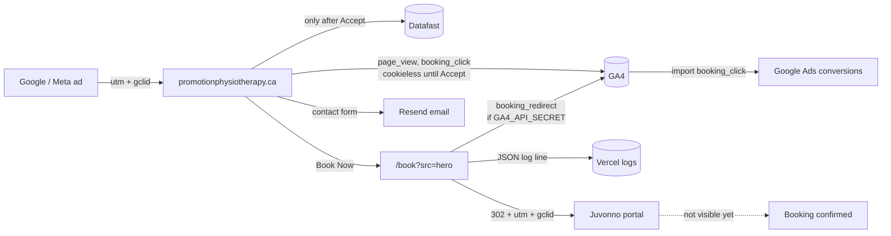
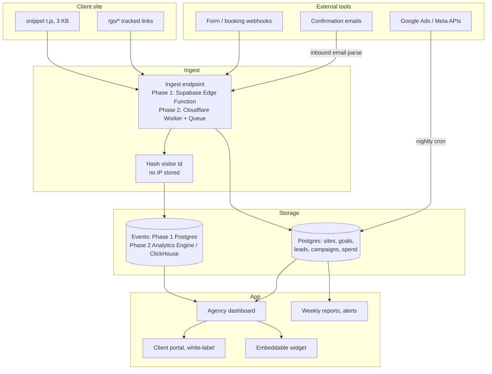

# Conversion analytics: legal check, current site architecture, and a resellable product

Written 2026-11-03. Three parts:

1. Is what was built on 2026-11-03 legal in Manitoba?
2. Architecture of the Pro-Motion site's tracking as it stands now.
3. Design for a resellable conversion-analytics product for agency clients (Lovable first, Cloudflare later), with a Lovable prompt and a market read.

This is an engineering assessment, not legal advice. Have a Manitoba privacy lawyer confirm before you rely on it for a client contract.

---

## Part 1. Manitoba legal check

### Which laws apply

| Law | Applies? | Why |
|---|---|---|
| PIPEDA (federal) | Yes | Manitoba's own private-sector act (PIPITPA, 2013) was never proclaimed, so federal PIPEDA governs commercial activity in Manitoba. Website analytics on a clinic site is commercial activity. |
| PHIA (Manitoba Personal Health Information Act) | Yes, for the clinic | A physiotherapist is a "trustee" under PHIA. It governs personal health information the clinic holds. Pre-booking web analytics are generally not PHI, but anything a visitor types about their condition is. |
| CASL | Only if you email leads | Commercial electronic messages need consent and an unsubscribe. Not triggered by analytics. |
| Google Ads policies | Yes | Physiotherapy ads are allowed in Canada without certification. The personalized-ads policy forbids targeting people based on health conditions. |
| GDPR / ePrivacy | No | Only if you deliberately market to EU residents. |

### What was built, item by item

| Component | Assessment |
|---|---|
| GA4 in Consent Mode v2, denied by default | Compliant. PIPEDA requires meaningful consent for cookies that track; the site collects no analytics cookies without an explicit Accept. Cookieless pings carry no persistent identifier. The IP still reaches Google transiently for geolocation, which is now disclosed on the privacy page. OPC guidance treats IP as potentially personal information, so disclosing it was the right fix. |
| Accept grants analytics_storage, ad_storage, ad_user_data; ad_personalization stays denied | Compliant and deliberately conservative. This lets Google Ads count conversions (ad_storage) but never builds personalised audiences. That also keeps you clear of the Google Ads health-personalisation policy. Keep it this way: never create remarketing lists from service pages like pelvic health or concussion. |
| `/book` redirect logging placement, page, country, device, UTM and click ids | Low risk. No IP, no cookie, no name. Country and device class are not identifying. The one thing to be aware of: `page` can reveal a condition interest (for example a pelvic-floor page). Because it is not linked to an identifiable person in our log, it is not PHI. Do not ever join this log to Juvonno patient records by time-matching; that would turn an anonymous click into a health record. |
| GA4 Measurement Protocol forwarding (only when `GA4_API_SECRET` is set) | Acceptable. Uses the visitor's own `_ga` cookie only if they consented; otherwise a daily-rotating hash that is never stored. The request comes from the server, so Google sees the server's IP, not the visitor's. Privacy page now describes the redirect. |
| Datafast loads only after Accept | Compliant. |
| Privacy page copy | Updated for cookieless mode, IP handling, and the redirect. |

### Things outside this change that the clinic should fix

These existed before and are more exposed than anything built today.

1. **Contact form goes through Resend (US)** and may contain health details. Under PHIA a trustee who lets a third party process PHI needs a written information-manager agreement (PHIA s. 25). Get a DPA from Resend and Vercel on file, or stop the form from accepting free-text health details. The privacy page already warns visitors not to include medical details, which helps but is not a substitute.
2. **The chat widget** (agent.rtstics.com) receives whatever visitors type. Same PHIA concern. Rtstics should have an information-manager agreement with the clinic, and the chat transcript retention policy should be written down.
3. **Retention statement.** The privacy page says nothing about how long analytics data is kept. Add one line: GA4 is set to 14 months (check GA4 Admin → Data retention), server click logs are kept for N days.
4. **Vercel request logs contain IPs.** Standard hosting, but it means the clinic should list Vercel as a service provider in its privacy notice.
5. **Google Ads conversion imports** will send `gclid` plus the event. That is allowed. Do not enable Enhanced Conversions (hashed email/phone) for a health clinic without a lawyer's sign-off, because it links a health-service conversion to a hashed identity on Google's side.

---

## Part 2. The Pro-Motion site today



What is counted where:

| Question | Answered by | Depends on consent? |
|---|---|---|
| How many visits, from which ad | GA4 (modelled when denied) | Partly |
| How many clicked Book Now, which button | `/book` log, and `booking_redirect` in GA4 | No |
| Same, but stitched to the session and campaign | GA4 `booking_click` | Yes |
| How many finished booking in Juvonno | Nothing yet. See the three Juvonno questions in `ads-tracking-and-analytics-access-plan.md` | n/a |
| Phone clicks | GA4 `phone_click` | Partly |
| Form submits | GA4 `generate_lead` | Partly |

---

## Part 3. A resellable conversion-analytics product

### The problem it solves

Agencies running ads for local-service businesses (clinics, builders, trades) cannot answer "how many leads did this campaign produce" because:

- The conversion happens on a third-party tool (Juvonno, Jane, Calendly, Typeform, a CRM form) the agency does not control.
- GA4 is cookie-gated, blocked by ad blockers, and too complex for the client to read.
- Reporting means hand-building Looker Studio dashboards per client.

The product is: one script tag plus a tracked-link and webhook layer that counts every lead regardless of where it completes, attributes it to the campaign, and shows the client a dashboard they can read without training. White-labelled so agencies resell it.

### What gets captured

| Signal | How | Consent needed (Canada) |
|---|---|---|
| Page views, referrer, UTM, click ids | Snippet, cookieless (daily-rotating hash computed on the server, Plausible-style) | No |
| Outbound clicks to booking tools, tel:, mailto: | Snippet, automatic | No |
| Form start and submit on the client's own site | Snippet, automatic by form id. Field names only, never values | No |
| Tracked redirect links (`/go/book`) | Edge redirect, server-side count, params forwarded | No |
| External form completed | Webhook from the form tool (Typeform, Jotform, Calendly, HubSpot, Jane), or a pixel on the thank-you page if the tool allows it | No |
| Booking completed in a tool with no webhook (Juvonno) | Email parsing: client forwards the booking-confirmation email to a per-site inbound address, product parses and counts it. Works with any system that sends an email. Also CSV upload | No, but PHI-aware (store count and timestamp only, discard the body) |
| Phone calls from ads | Dynamic number insertion via Twilio, swapped only for paid visitors | No |
| Ad spend per campaign | Google Ads and Meta Marketing APIs, nightly | n/a |
| Session recording, heatmaps | Optional, consent-gated | Yes |

### Attribution and metrics the dashboard shows

- Visits, leads, cost per lead, by campaign, ad group, keyword (from gclid lookup), landing page, device, city.
- Funnel per site: visit → engaged (30 s or 2 pages) → intent click (Book Now, phone, form start) → lead (form submit, webhook, parsed email) → customer (CRM status or manual).
- First-touch and last-touch per lead, with a 90-day window.
- Weekly email summary and a shareable client link. Agency branding, custom domain.
- Embeddable widget (`<iframe>` or web component) so a client can drop "this month's leads" into their own site or intranet.

### Architecture

Phase 1 (Lovable, weeks 1 to 4) and phase 2 (Cloudflare, when ingest exceeds a few million events a month) share the same data model; only the ingest path moves.



### Data model (Postgres, both phases)

```
agencies(id, name, logo_url, custom_domain, plan)
users(id, agency_id, email, role)                 -- owner, member, client_viewer
sites(id, agency_id, name, domain, public_key, timezone, created_at)
goals(id, site_id, name, kind, match)             -- kind: event | path | outbound_host | form_id | webhook | email_rule | redirect
events(site_id, ts, name, visitor_hash, session_id, path, referrer,
       utm_source, utm_medium, utm_campaign, utm_content, utm_term,
       gclid, fbclid, msclkid, device, browser, country, region, city, props jsonb)
sessions_daily(site_id, day, visitor_hash, first_path, first_source, first_campaign, pages, duration_s)
leads(id, site_id, goal_id, ts, source, medium, campaign, landing_path,
      first_touch_campaign, last_touch_campaign, external_ref, value, status)  -- status: new | contacted | booked | customer | lost
tracked_links(id, site_id, slug, destination, goal_id)
webhooks_in(id, site_id, provider, secret, goal_id, field_map jsonb)
email_rules(id, site_id, inbound_address, subject_match, goal_id)
ad_accounts(id, site_id, provider, external_id, oauth_tokens_enc)
ad_spend_daily(site_id, day, provider, campaign_id, campaign_name, cost, clicks, impressions)
```

Leads never store name, phone, email or message body by default. If a client wants lead details, that is an explicit per-site setting with a DPA, stored encrypted, and excluded from analytics queries.

### The snippet (what the one script tag does)

```html
<script defer src="https://cdn.<your-domain>/t.js" data-site="pk_live_abc123"></script>
```

- Sends `pageview` on load and on history changes (SPA-safe).
- Reads `utm_*`, `gclid`, `fbclid`, `msclkid` from the URL once and keeps them in `sessionStorage` for the visit, so a form submitted three pages later still attributes to the ad.
- Auto-detects: clicks on `tel:`, `mailto:`, outbound links whose host is on the site's booking-host list, `<form>` submit (sends form id or action path and field count only).
- `window.ca('event', 'quote_requested', {value: 500})` for custom goals.
- No cookies. Visitor id is computed server-side as `sha256(site_key + ip + user_agent + daily_salt)`, so the id changes every day and the IP is never written anywhere.
- Respects `navigator.globalPrivacyControl` by dropping to pageview-only.
- Under 3 KB gzipped, loads async, never blocks the page.

### Why Lovable first, then Cloudflare

Lovable gets you a working React dashboard on Supabase in days. Supabase gives Postgres, auth, row-level security for multi-tenancy, Edge Functions for the ingest endpoint, and a Canadian region (ca-central-1) for data residency, which matters when you sell to clinics.

The ingest path is the only part that will not scale on Supabase Edge Functions past a few million events a month. In phase 2 move exactly that path to a Cloudflare Worker writing to Workers Analytics Engine (cheap time-series with SQL) or ClickHouse Cloud, keep Postgres for everything else, and serve the snippet from Cloudflare's CDN. Nothing in the dashboard changes because it reads through the same API.

Phase 2 stack: Workers (ingest, redirect links, webhook receivers), Queues (buffer), Analytics Engine or ClickHouse (events), D1 or Neon Postgres (app data), KV (site config at the edge), R2 (raw event archive and email bodies for 24 h), Cron Triggers (spend sync, rollups, weekly reports), Email Workers (inbound booking-email parsing), Pages (dashboard).

### Lovable prompt (phase 1)

Paste this as the first message. Then iterate screen by screen.

```
Build a multi-tenant conversion analytics SaaS for marketing agencies and their local-business clients. Use React + TypeScript + Tailwind + shadcn/ui on the front end and Supabase (Postgres, Auth, Edge Functions, RLS) on the back end. Region: Canada.

Tenancy: agencies → users (roles: owner, member, client_viewer) → sites. Every table has agency_id or site_id and row-level security so an agency only sees its own data and a client_viewer only sees the sites they are assigned.

Tables: agencies, users, sites, goals, events, sessions_daily, leads, tracked_links, webhooks_in, email_rules, ad_accounts, ad_spend_daily. (Use the column lists I will paste next.)

Edge Functions:
1. POST /ingest — accepts {site_key, name, path, referrer, utm_*, gclid, fbclid, msclkid, props, screen_w}. Looks up the site by public key, computes visitor_hash = sha256(site_key + client IP + user agent + today's date + server secret) WITHOUT storing the IP, assigns a session_id (same visitor_hash within 30 minutes), derives device/browser/country from headers, inserts into events. If the event matches a goal for the site (by event name, path pattern, outbound host, or form id), also insert a lead with first-touch and last-touch campaign resolved from that visitor's earlier events today. Return 204 fast. CORS open.
2. GET /go/:site/:slug — looks up tracked_links, inserts an event named redirect_click with the slug and any utm/click-id params, then 302-redirects to the destination with those params appended. Set Cache-Control: no-store.
3. POST /webhook/:site/:webhook_id — verifies the shared secret, maps provider fields with field_map, inserts a lead on the configured goal. Store only timestamp, external_ref and campaign fields; never store names, emails or free text unless the site setting store_lead_details is true.
4. A nightly scheduled function that pulls yesterday's spend by campaign from Google Ads and Meta (stub the API clients behind an interface so I can wire real credentials later) into ad_spend_daily.

Snippet: generate a static /t.js (vanilla JS, no dependencies, < 3 KB) that: sends pageview on load and pushState/popstate; stores utm_* and click ids in sessionStorage on first landing and attaches them to every event; auto-tracks clicks on tel:, mailto:, and outbound links to hosts listed in the site's booking_hosts setting; auto-tracks form submit with the form id/action only; exposes window.ca(name, props). No cookies, no localStorage.

Screens:
- Agency dashboard: list of client sites with this month's visits, leads, cost per lead, and trend vs last month.
- Site overview: date range picker; KPI tiles (visits, intent clicks, leads, cost per lead); funnel visit → engaged → intent → lead; leads by campaign table with spend and CPL; leads by source/medium; top landing pages; device and city breakdown; live view of the last 20 events.
- Goals: create/edit goals of each kind with a live "matched 12 events in the last 7 days" preview.
- Tracked links: create slug + destination, copy button, per-link clicks.
- Integrations: webhook URLs with secret, inbound email address per rule, Google Ads / Meta connect buttons (OAuth stubs).
- Install: the script tag, a verification check that pings /ingest from the browser, and a "we received your first event" state.
- Client portal: same site overview, read-only, agency logo and colours, shareable link with magic-link auth.
- Embed: a /embed/:site/:token route that renders a compact KPI card for use in an iframe.
- Settings: agency branding, custom domain (CNAME instructions), data retention (default 25 months events, 5 years leads), store_lead_details toggle with a consent warning.

Design: clean, light, dense tables, no marketing fluff. Charts with Recharts. Every number must have a tooltip that says exactly how it is computed.

Seed the database with one demo agency, two sites, 60 days of realistic events, goals, leads and spend so every screen renders with data.
```

Follow-up prompts to send after the first build: (1) the exact column list from the data model above, (2) "add the inbound-email rule parser as an Edge Function that accepts a forwarded email via a webhook from an inbound email provider and counts a lead if the subject matches", (3) "add weekly summary emails via Resend", (4) "add CSV import of leads with a date column and campaign column".

### What exists in the market

| Product | What it is | Starting price (approx.) | Where it falls short for your use |
|---|---|---|---|
| WhatConverts | Lead tracking for agencies: forms, calls, chats, attribution, white-label | ~US$30 per site per month, agency plans higher | Closest competitor. Cookie-based, US-hosted, no health-sector privacy posture, no email-parse for tools like Juvonno. |
| CallRail | Call tracking, plus form tracking | ~US$45 per month | Phone-first. Expensive once you add forms. |
| Ruler Analytics, Dreamdata, Attributer | Lead attribution | US$100 and up | Priced for B2B SaaS, not a $2k/month physio ad budget. |
| Hyros, Triple Whale, Cometly | Ad attribution for e-commerce and info-products | US$100 to $500+ | Wrong vertical. |
| Plausible, Fathom, Umami, Simple Analytics, Pirsch | Privacy-first web analytics | US$9 to $19 per month | Great cookieless model to copy. No lead attribution, no ad spend, no client reporting, no webhooks from booking tools. |
| AgencyAnalytics, Databox, Swydo, DashThis | Agency reporting dashboards | US$60 to $80+ per month | Report on other tools' data; do not collect anything themselves. Still blind to third-party booking completions. |
| PostHog, Mixpanel | Product analytics | Free tier, then usage | Built for SaaS products, overwhelming for a clinic owner. |
| GA4 + Looker Studio | What everyone uses | Free | Consent-gated, blocked by ad blockers, needs an analyst to read. This is the pain you are selling against. |

### Is there a business here

Honest read:

- **The category exists and people pay for it.** WhatConverts and CallRail prove agencies pay US$30 to $100 per client site per month for lead attribution. That is your price anchor.
- **Generic is crowded.** "Privacy-first analytics" and "agency reporting" are both saturated. A generic launch competes with ten funded companies.
- **The wedge is vertical.** Nobody serves "Canadian healthcare and home-services clients whose bookings complete in a third-party tool" with a PHIA/PIPEDA-aware, Canada-hosted, cookieless product that counts bookings via tracked links, webhooks and confirmation-email parsing. That wedge is small but real, you already have design-partner clients, and the integrations list (Juvonno, Jane, Cliniko, Noterro for clinics; Jobber, Housecall Pro, ServiceTitan for trades) becomes a moat other analytics vendors will not bother with.
- **Distribution is the real question.** Your first customers are your own clients (bundle it into retainers), then other Canadian agencies in the same verticals. Resale to "a person who runs a website" is a weaker channel; they do not know they need attribution until an agency tells them.
- **Build cost is low** because phase 1 is Lovable plus Supabase, and the snippet is a weekend of work. The expensive parts later are the ad-platform API integrations (Google Ads API approval takes weeks, Meta app review likewise) and keeping booking-tool integrations working.

Suggested path: ship phase 1 for Pro-Motion and the builder client, price it into their retainer, get three months of real data, then decide whether to sell it outside Rtstics.
